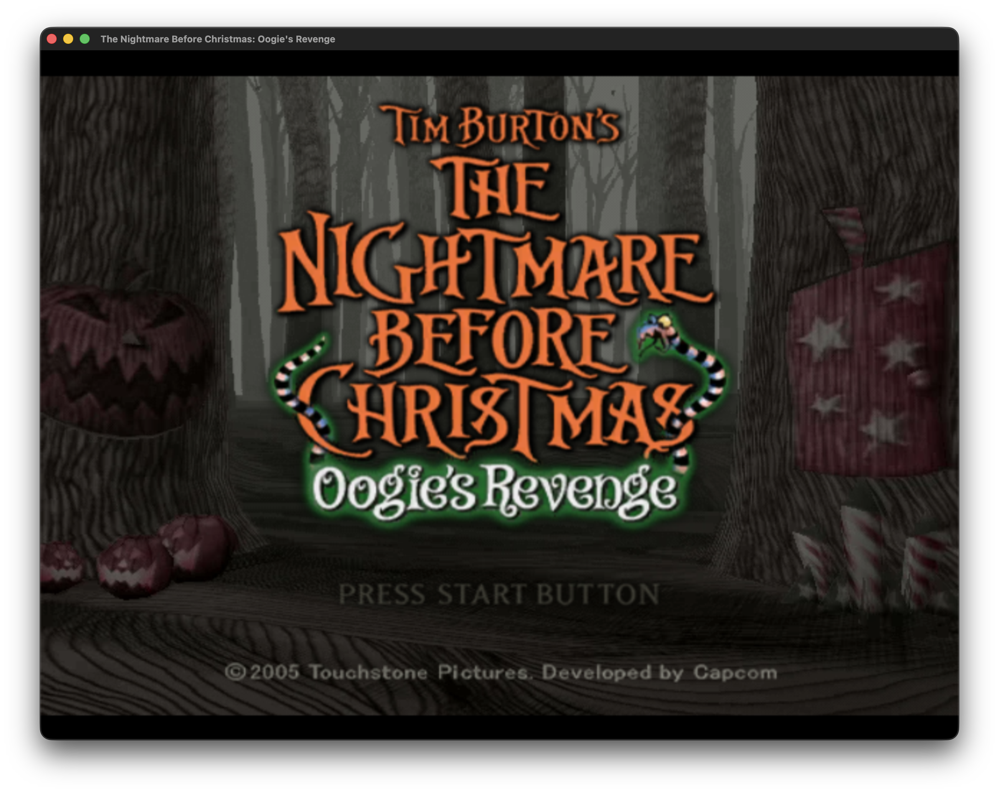
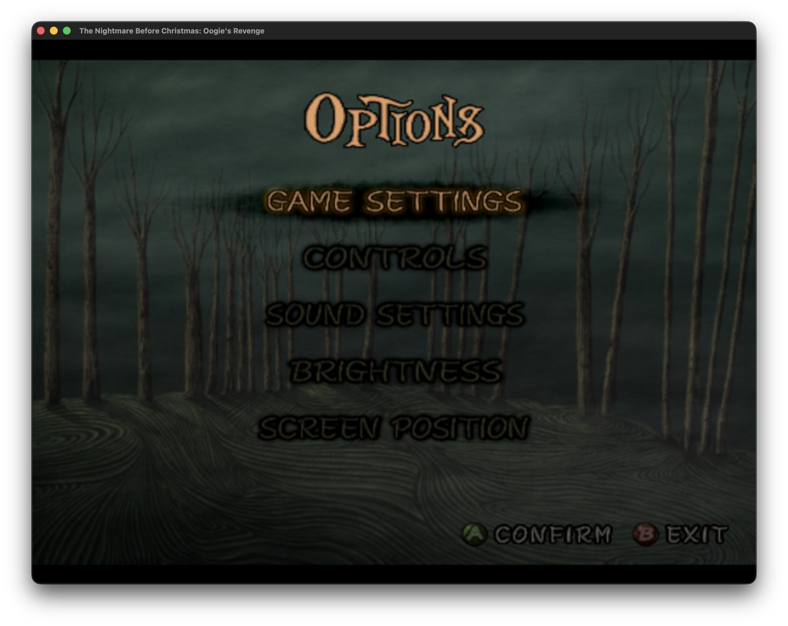
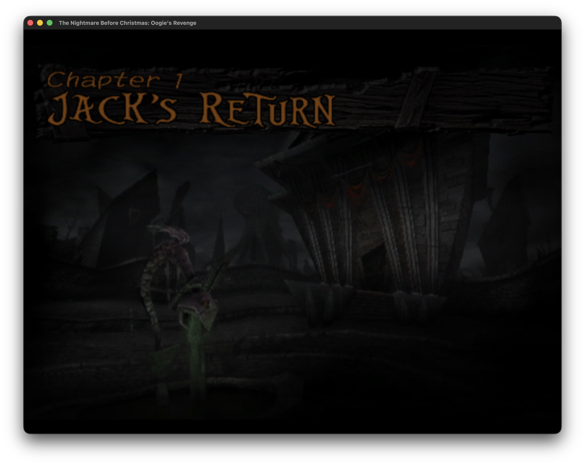
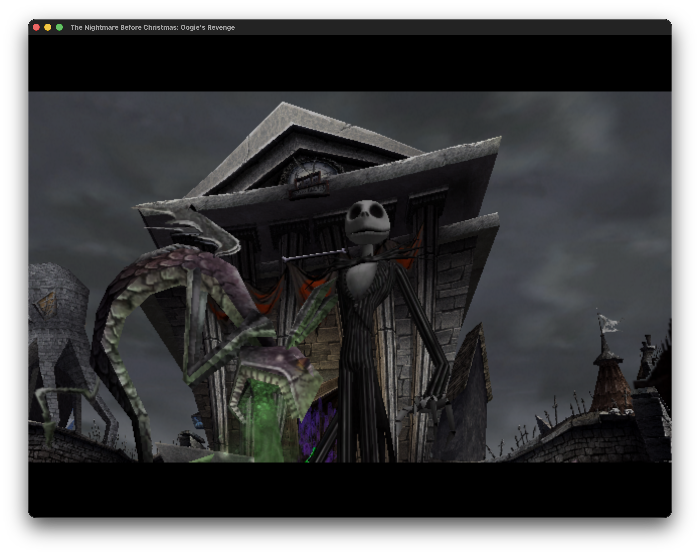
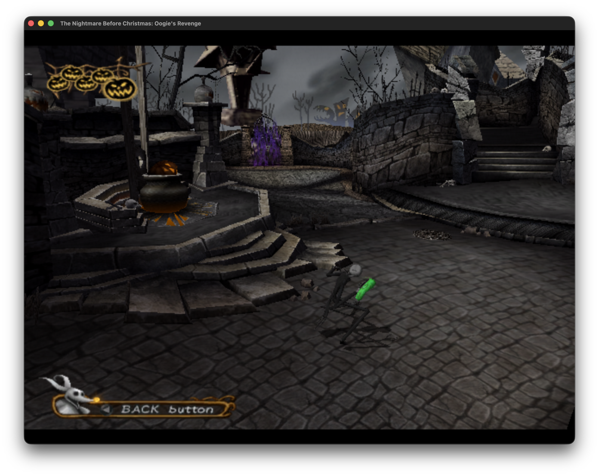
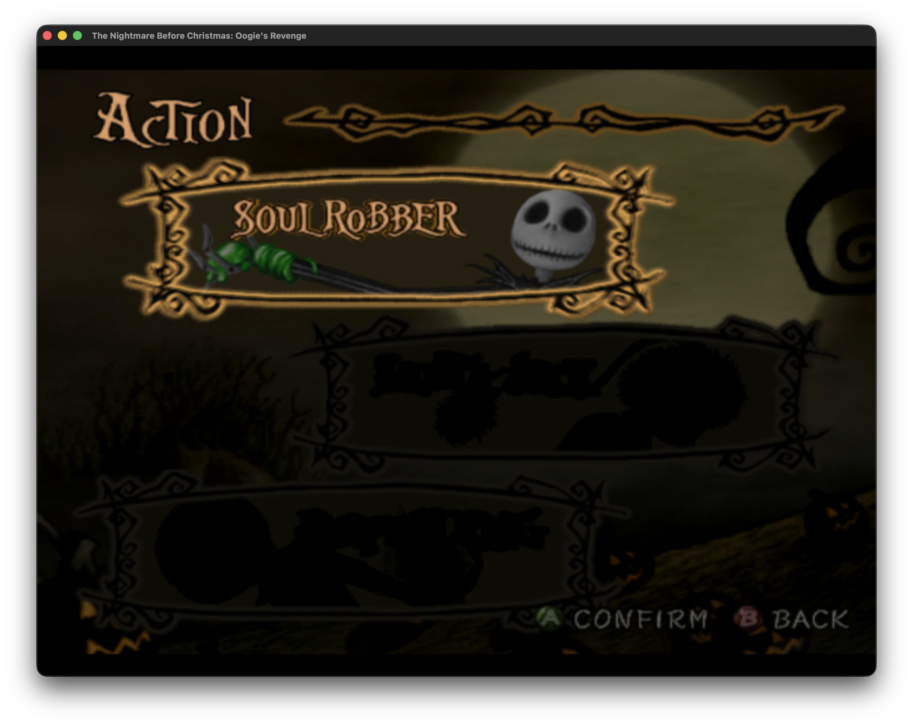

# *The Nightmare Before Christmas: Oogie's Revenge* - Native PC Port

### Native PC Reimplementation Engine & C++17 Reverse-Engineering Toolkit

[](https://en.cppreference.com/w/cpp/17)
[-lightgrey.svg)]()
[]()
[](https://github.com/ocornut/imgui)
[](LICENSE)
[](https://www.patreon.com/BlacklineInteractive)
[](https://ko-fi.com/blacklineinteractive)

<p align="center">
  
</p>

A modern, high-performance **native PC port** and reverse-engineering toolkit for Capcom's 2004-2005 classic: ***Tim Burton's The Nightmare Before Christmas: Oogie's Revenge*** (Original Xbox / PS2).

Instead of running inside an emulator or waiting for a multi-year decompilation, the game's original x86 machine code runs **natively on the host CPU** with a 1:1 mapped PE binary, while graphics, input, audio, and OS calls are translated to modern Win32 and Direct3D 9 APIs.

---

## In-Game Screenshots (Native PC Port running under Wine / Direct3D 9)

| Title Screen (*Press Start Button*) | Options Menu |
| :---: | :---: |
|  |  |
| **Chapter 1: Jack's Return (Intro)** | **Cinematic Cutscene (Jack at Town Hall)** |
|  |  |
| **Active 3D Gameplay (Halloween Town)** | **In-Game Action Menu (Soul Robber)** |
|  |  |

> **Current status:** the port boots through the logos, title and menus into the levels, on Windows and under Wine on macOS. Jack (skinned animation, Soul Robber combos), the 3D levels with the game's own lighting (NV2A pixel shaders translated to HLSL), the HUD and the pause / inventory menus work.
>
> Bink movies play (the game's own YUV → RGB combiner shader), still without sound.
>
> **Not yet:** sound (XACT is silent), render-to-texture effects (the Soul Robber glow), fog, the game's gamma ramp. Stencil shadows render correctly but are off by default (`PC_SHADOWS=1`): the game advances one logic step per frame, and with shadows it runs below 60 FPS, so in slow motion.

---

## Contents

- [Quick Start: Running the PC Port](#quick-start-running-the-pc-port)
- [How It Works (Architecture)](#how-it-works-architecture)
- [Debug Switches](#debug-switches)
- [3D Stage Viewer & Research Toolkit](#3d-stage-viewer--research-toolkit)
- [Technical Documentation](#technical-documentation)
- [Project Structure](#project-structure)
- [Support & Sponsor](#️-support--sponsor)
- [License](#license)

---

## Quick Start: Running the PC Port

You need your own copy of the game: an image of the **Xbox** disc (the European release, `Oogie's Revenge (Europe) (En,Fr,De,Es,It)`, is the one tested). No game files are in this repository.

**Requirements**

| | macOS | Linux | Windows |
| :--- | :--- | :--- | :--- |
| Python | 3.8+ | 3.8+ | 3.8+ |
| C compiler | Apple clang (Xcode command line tools) | clang | clang (LLVM) |
| Runner | Wine (`brew install --cask wine@devel`) | Wine | native (Git Bash for `pc.sh`) |

Nothing else: the C part (`src/PC`) has no headers or libraries to install, it declares the few Win32 / Direct3D 9 pieces it uses (`src/PC/win32.h`) and loads `d3d9.dll` and `d3dcompiler_47.dll` at run time (both ship with Windows and Wine).

**1. Clone**

```bash
git clone --recursive https://github.com/BlackLineInteractive/nightmare-before-christmas-pc.git
cd nightmare-before-christmas-pc
```

**2. Build** (put the disc image in `rom/` first; the first build extracts it to `rom/extracted/`)

```bash
./pc.sh build
```

This writes `rom/extracted/default_pc.exe`. Rebuild after changing anything in `src/PC` or `tools/`.

**3. Run**

```bash
./pc.sh run
```

Controls (or an XInput gamepad):

| Keys | Pad | Keys | Pad |
| :--- | :--- | :--- | :--- |
| WASD | left stick | Space / X / C / V | A / B / X / Y |
| IJKL | right stick | Q / E | left / right trigger |
| arrows | d-pad | 1 / 2 | white / black |
| Enter / Esc | Start / Back | F / H | stick clicks |
 Saves go to `rom/extracted/` (the Xbox `U:` drive). `./pc.sh clean` removes the build output, screenshots and traces.

---

## How It Works (Architecture)

The original Xbox uses an Intel Pentium III (x86 32-bit). Because modern PCs also run x86 instructions natively, the game code executes directly on the CPU without emulation overhead.

```text
[ Original default.xbe (Xbox) ]
                 │
                 ▼ (tools/build_flat_pe.py)
[ Flat Windows PE: default_pc.exe ]
  ├── 1. Memory mapped at base 0x00010000 (1:1 with Xbox layout)
  │      ↳ All absolute pointers, jump tables, Capcom globals stay valid
  │
  ├── 2. Hardware patches (NV2A MMIO neutralized)
  │      ↳ D3D_WaitGPUReady spin-waits & NV2A register polling patched to NOPs
  │
  ├── 3. XAPI / Kernel thunking -> Win32 (tools/xapi_port.py)
  │      ↳ Xbox APIs jump directly to kernel32.dll / ntdll.dll twins
  │      ↳ Drive paths (D:\, U:\) mapped to game directories
  │
  └── 4. Native PC backend (src/PC/)
         ├── D3D8 (Xbox) ──────► Direct3D 9 (render.c, draw.c)
         ├── NV2A Shaders ─────► HLSL (nv2a_vsh.py)
         ├── XPP Gamepad ──────► XInput + Keyboard (input.c)
         ├── NV2A combiners ───► HLSL pixel shaders (nv2a_psh.py, pshader.c)
         └── XACT Sound ───────► silent stubs for now (audio.c)
```

### Porting Route

Static analysis confirmed **the game code itself (`0x12000`-`0x1A0000`) never calls the Xbox kernel**. All 125 kernel imports belong to Microsoft's statically linked libraries, which we replace:

| Library | Location | Kernel calls | PC Replacement |
| :--- | :--- | ---: | :--- |
| **XAPI + LIBC** | `.text` `0x1A0000`-`0x1D22A8` | 320 | Direct jumps to Win32 `kernel32.dll` / `ntdll.dll` |
| **D3D8 (NV2A)** | `D3D` | 37 | Direct3D 9 backend (`src/PC/render.c`, `draw.c`, `vshader.c`) |
| **XPP (Input)** | `XPP` | 160 | XInput + Keyboard mapping (`src/PC/input.c`) |
| **XACT / DSOUND** | `XACTENG` / `DSOUND` | 326 | Audio stubs & notification pumps (`src/PC/audio.c`) |
| **WMADEC** | `WMADEC` | 13 | Audio decoder (stubbed) |

---

## Debug Switches

Control runtime behavior via environment variables:

| Variable | Effect |
| :--- | :--- |
| `PC_SHOT=<n>` | Save the back buffer to `shot_<frame>.bmp` at frames *n*, 3*n*, 6*n* (**F12** saves anytime) |
| `PC_DUMPTEX=1` | Dump every uploaded texture to `tex_<addr>.bin` (header + raw data) |
| `PC_TRACE=<n>` | Log draw calls of frame *n* (prim, count, stride, shader, textures, blend states) |
| `PC_FLAT=1` | Draw without the game's pixel shaders (Direct3D 9 texture stages only) |
| `PC_SHADOWS=1` | Turn the stencil shadows on (`v`: only the volumes, `s`: only the shading pass) |

Press **T** at runtime to trace the next frame (one line per draw, plus `tr__*.bmp` screenshots at each vertex shader change). Every 64 frames the log shows FPS and where the frame time goes (Present, draw calls, texture uploads, vertex bytes copied, batched draws).

### Performance notes

Direct3D 9 under Wine on macOS goes through wined3d and OpenGL, which costs ~30-100 µs per draw call. The renderer caches the game's vertex buffers in MANAGED buffers (checksummed once per frame), streams the rest through one SYSTEMMEM ring, skips redundant state changes and batches the ~1700 tiny shadow strips per frame into a few hundred draws. Menus run at 60 FPS; levels at 30-60 without shadows.

---

## 3D Stage Viewer & Research Toolkit

Alongside the binary port, **OogieEngine** includes a C++17 standalone viewer for inspecting extracted game assets:

- **Stage Browser:** Explore 365 cataloged stages (Halloween Town, Hinterlands, Lab, Casino, Christmas Town, Graveyard).
- **Model Hierarchy Inspector:** Toggle props, inspect vertex/poly counts, view bounding boxes.
- **Texture Gallery:** Real-time thumbnail preview of DXT1/DXT5 and `.pig` textures.
- **Dialogue Reader:** Multi-language BMS script viewer.
- **Dual Camera Navigation:** Turntable Orbit (LMB) & 6-DOF Flycam (RMB + WASD, Q/E).

### Building the Viewer (macOS)

```bash
cmake -B build -DCMAKE_BUILD_TYPE=Release
cmake --build build -j$(nproc 2>/dev/null || sysctl -n hw.ncpu)

# Run interactive viewer
./build/oogie_viewer

# Or inspect a specific stage
./build/oogie_viewer rom/structured_data/stages/020a
```

### Camera Controls

| Action | Control |
| :--- | :--- |
| **Turntable Orbit** | **LMB Drag** |
| **First-Person Fly** | **Hold RMB + WASD** |
| **Vertical Fly (Up/Down)** | **Q / E** (while holding RMB) |
| **Speed Boost / Adjust** | **Shift** / **Mouse Wheel** |
| **Pan / Zoom View** | **MMB Drag** / **Mouse Wheel** |
| **Focus Bounds / Grid** | **F** / **G** |
| **Render Modes** | **1** (Textured), **2** (Vertex Color), **3** (Wireframe), **4** (Flat), **5** (Normals) |

---

## Technical Documentation

Full reverse-engineering analysis and format specifications are documented in:  
👉 **[`docs/REVERSE_ENGINEERING_SPECIFICATION.md`](docs/REVERSE_ENGINEERING_SPECIFICATION.md)**

Includes: `default.xbe` structure, Capcom LZ Type 2 decompression, `@STM` containers, `P2OD`/`BMD`/`PMT` 3D formats, material flags (`ADD100`, `GLARE`, `TEX_SCROLL`), and collision meshes (`BGatari.amd`).

---

## Project Structure

```
├── media/                   # In-game screenshots & documentation assets
├── include/OogieEngine/     # Public C++ Header API (Core, Loader, Rendering, UI)
├── src/
│   ├── PC/                  # The port's runtime: D3D9 renderer, shaders, input, audio, memory, libc glue
│   │                        #   (one i386 object, linked into default_pc.exe by tools/coff_link.py)
│   ├── Host/                # Earlier HLE-kernel prototype (CMake target oogie_port, not used by the port)
│   ├── Viewer/              # Interactive 3D asset viewer app
│   └── SG/, Loader/         # Scene graph, P2OD & STM parsers
├── docs/                    # Reverse-Engineering specifications
├── rom/                     # Your disc image and its extracted files (not in git)
├── pc.sh                    # build / run / clean the PC port
└── tools/
    ├── build_flat_pe.py     # default.xbe -> default_pc.exe generator (patches, sections, linking)
    ├── xapi_port.py         # XAPI -> Win32 tables, drive path patches
    ├── pc_render.py         # D3D8 / XPP / XACT entry points -> src/PC, compiles src/PC
    ├── coff_link.py         # links the src/PC object at a fixed address
    ├── nv2a_vsh.py          # NV2A vertex shaders -> HLSL
    ├── nv2a_psh.py          # NV2A register combiners (pixel shaders) -> HLSL
    ├── xbsymscan.py         # finds XDK library functions in default.xbe
    ├── extract_xbox_iso.py  # XDVDFS disc image extractor
    ├── capcom_tool.py       # LZ decompression & @STM extraction (viewer data)
    ├── structure_stm.py     # catalogues extracted stages for the viewer
    └── legacy/              # early prototypes, not used
```

---

## ❤️ Support & Sponsor

If you enjoy this project and want to support its active development, reverse-engineering research, and hardware testing, consider supporting us:

- **Ko-fi:** [ko-fi.com/blacklineinteractive](https://ko-fi.com/blacklineinteractive)
- **Patreon:** [patreon.com/BlacklineInteractive](https://www.patreon.com/BlacklineInteractive)

Every bit of support helps keep the project moving forward towards a fully playable PC release!

---

## License

This project is licensed under the **GNU General Public License v3.0 (GPLv3)** - see the [LICENSE](LICENSE) file for details.

This reverse-engineering toolkit and native port are developed strictly for educational and preservation purposes.  
*Tim Burton's The Nightmare Before Christmas: Oogie's Revenge* and its assets are the property of Disney Interactive, Buena Vista Games, and Capcom Co., Ltd.
