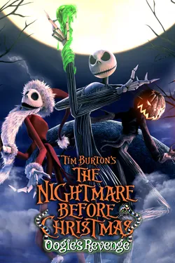

# OogieEngine - *The Nightmare Before Christmas: Oogie's Revenge*

### Native C++17 Reverse-Engineering Toolkit & PC Reimplementation Engine

[](https://en.cppreference.com/w/cpp/17)
[]()
[]()
[](https://github.com/ocornut/imgui)

<p align="center">
  
</p>

**OogieEngine** is a modern, high-performance reverse-engineering toolkit and native game engine recreation for Capcom's 2004–2005 classic: ***Tim Burton's The Nightmare Before Christmas: Oogie's Revenge*** (Original Xbox / PS2).

Inspired by modern engine reconstruction projects such as [*OpenGOAL*](https://github.com/open-goal/jak-project), [*OpenLara*](https://github.com/XProger/OpenLara), and [*Climax Game Engine Toolkit*](https://github.com/BlackLineInteractive/Climax_Game_Engine_Toolkit), this project extracts, decodes, and renders the game's proprietary **Capcom RD3 Engine** formats at high framerates with customizable shaders, a comprehensive Dear ImGui debugging suite, and a roadmap toward a full playable PC port.

---

## Key Features

- **Bitstream LZ Type 2 Decompressor:** Fast, pure Python & C++ bit-level dictionary decompressor for all `.lz` game archives.
- **Recursive `@STM` Unpacker:** Parses multi-file Capcom stage packages containing geometry, textures, scripts, sounds, and collision meshes.
- **3D Level & Mesh Renderer:** Full hardware-accelerated rendering of Capcom's `P2OD` 3D model formats with coordinate system correction (negative Y to OpenGL Y-up) and automatic surface normal recalculation.
- **Triangle Strip `0x8000` Reconstruction:** Reverse-engineered 4th vertex coordinate flag to cleanly reconstruct triangle strips, handle restart points, and eliminate degenerate polygon spikes.
- **PS2 GS Vertex Color Modulation:** Decodes baked vertex ambient occlusion and light values mapped to the PS2 Graphics Synthesizer $0..128$ intensity scale.
- **Two-Pass Scene Graph:**
  - **Pass 1 (Opaque & Cutout):** Renders environmental geometry with alpha masking (`discard if alpha < 0.20`) and depth writes.
  - **Pass 2 (Additive & Blended):** Renders spotlights, lantern cones, glows, and glares (`ADD100`, `GLARE`) with `GL_ONE, GL_ONE` additive blending and disabled depth writes.
- **Dual Camera Navigation:**
  - **Turntable Orbit (LMB Drag):** Natural orbit with configurable pitch/yaw inversion and exponential wheel zoom.
  - **Unreal/Unity Fly Navigation (RMB Hold + WASD):** 6-DOF freecam flight with Shift boost, Q/E vertical traversal, and dynamic speed adjustment.
- **Modern UI Suite (Dear ImGui):**
  - **Stage Browser:** Explore 365 cataloged stages categorized across Halloween Town, Hinterlands, Dr. Finkelstein's Lab, Oogie's Casino, Christmas Town, and the Graveyard.
  - **Model Hierarchy Inspector:** Toggle visibility of individual props, inspect vertex/triangle counts, and focus camera bounds with one click.
  - **Texture Gallery:** Real-time thumbnail preview of all DXT1/DXT5 and `.pig` textures.
  - **Story & Dialogue Reader:** View Japanese/English dialogue scripts from stage `.bms` and `.txt` files.

---

## Technical Documentation

Full reverse-engineering analysis and format specifications are documented in:
👉 **[`docs/REVERSE_ENGINEERING_SPECIFICATION.md`](docs/REVERSE_ENGINEERING_SPECIFICATION.md)**

Topics covered:

1. **Executable Analysis (`default.xbe`):** Native 32-bit x86 Intel architecture, 31 sections, Capcom source code tree (`\Project\nightmareXbox\app\...`), player states (`JACK_00`..`JACK_16`).
2. **Container Formats:** Capcom LZ Type 2 decompression algorithm and `@STM` format specification.
3. **Model Formats:** `P2OD` (static stages), `BMD` (skinned skeletal characters), and `PMT` (134 skeletal animation files).
4. **Material Grammar:** Semantic flags in `scene/bg_list.txt` (`ADD100`, `GLARE`, `ADDZERO_64`, `ALPHA`, `Z_OFF`, `TEX_SCROLL`).
5. **Collision & Audio:** `BGatari.amd` environment collision, `CAMatari.amd` camera obstruction, and Microsoft XACT audio banks (`.xwb` / `.xsb`).
6. **Native PC Port Roadmap:** Phased development plan to achieve a fully playable standalone game.

---

## Building & Running

### Prerequisites

- **C++17 Compiler:** Clang 14+ (macOS Xcode), GCC 10+, or MSVC 2019+
- **CMake:** Version 3.20 or newer
- **Raylib:** Version 5.0+ (`brew install raylib` on macOS)

### Build Instructions

```bash
# Clone the repository
git clone https://github.com/vovavovchok/oogie-capcom-engine.git
cd oogie-capcom-engine

# Configure and compile
cmake -B build -DCMAKE_BUILD_TYPE=Release
cmake --build build -j$(nproc 2>/dev/null || sysctl -n hw.ncpu)
```

### Running the Viewer

```bash
# Launch interactive viewer (loads Halloween Town by default)
./build/oogie_viewer

# Or launch directly into a specific stage (e.g. Dr. Finkelstein's Lab)
./build/oogie_viewer rom/structured_data/stages/020a
```

---

## Native PC Executable Patching (Hardware Dependency Stripper)

To convert the original Xbox `default.xbe` / `default.exe` into a native, standalone Windows PE executable stripped of all console hardware dependencies:

```bash
# Run binary patcher
python3 tools/patch_exe.py
```

### What this accomplishes directly on the binary:
1. **NV2A GPU Spinlock Neutralization (`0x001dc611`):** Overwrites the hardware register wait loop (`D3D_WaitGPUReady`) with `xor eax, eax; ret`, preventing hangs on systems without NV2A silicon.
2. **NV2A MMIO Hardware Init Stripping (`0x001dc2d1`):** Removes hardcoded writes to physical address `0xFD000000` (NV2A PCI/PGRAPH registers) and chip ID reads.
3. **Interrupt Status Register Stripping (`0xFD40014C`):** Replaces hardware register polling at `0x001dbc1d`, `0x001dbe5f`, and `0x001dc00f` with zeroed registers.
4. **XPP USB Controller Hardware Patching (`0x0025c41f`):** NOPs hardware MMIO writes.
5. **Standard Windows PE Import Table (`.idata`):** Constructs a full PE Import Directory connecting all 125 Xbox kernel ordinals at VA `0x00260020` directly to `xboxkrnl.dll`.
6. **Outputs:**
   - `rom/extracted/default_pc.exe` & `rom/extracted/OogiesRevenge_PC.exe` (Standalone Windows executables).
   - `rom/extracted/xboxkrnl.dll` (Standard Win32 ordinal thunk library).

---

## Camera Controls

| Action | Control |
| :--- | :--- |
| **Turntable Orbit** | **LMB Drag** (Left Mouse Button) |
| **First-Person Fly** | **Hold RMB + WASD** (Right Mouse Button + Keys) |
| **Vertical Fly (Up/Down)** | **Q / E** (while holding RMB) |
| **Fly Speed Boost** | **Shift** |
| **Fly Speed Adjust** | **Mouse Wheel** (while holding RMB) |
| **Pan View** | **MMB Drag** (Middle Click) or **Shift + LMB** |
| **Zoom View** | **Mouse Wheel** |
| **Focus All Bounds** | **F** |
| **Toggle Ground Grid** | **G** |
| **Render Modes** | **1** (Textured), **2** (Vertex Color), **3** (Wireframe), **4** (Flat), **5** (Normals) |

---

## Project Structure

```
├── include/OogieEngine/     # Public C++ Header API
│   ├── Core/                # CPU Data Types (Vec3, Mat4, Vertex, ModelData, StageConfig)
│   ├── Loader/              # Format Parsers (PodLoader, SceneLoader)
│   ├── Rendering/           # GPU Abstractions (GPUMesh, GPUTexture, Camera)
│   ├── SG/                  # Scene Graph (SceneNode, StageScene)
│   ├── UI/                  # Panels (StageBrowser, ModelInspector, TextureGallery, Dialogue)
│   └── Viewer/              # Application State & ViewerApp
├── src/                     # C++ Implementation Files
├── docs/                    # Reverse-Engineering Specifications & Documentation
├── rom/
│   ├── extracted/           # 100% Unpacked Xbox Disc (ISO payload, default.xbe)
│   └── structured_data/     # Structured Stages (0000..0c00) with Catalog
└── tools/
    ├── capcom_tool.py       # Bitstream LZ & @STM Extraction Utility
    └── structure_stm.py     # Stage Structuring & Catalog Generation Tool
```

---

## License

This reverse-engineering toolkit is developed for educational and preservation purposes.  
*Tim Burton's The Nightmare Before Christmas: Oogie's Revenge* is the property of Disney Interactive, Buena Vista Games, and Capcom Co., Ltd.
