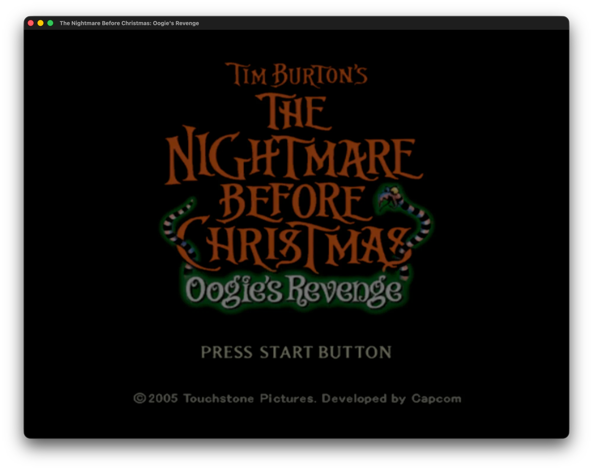
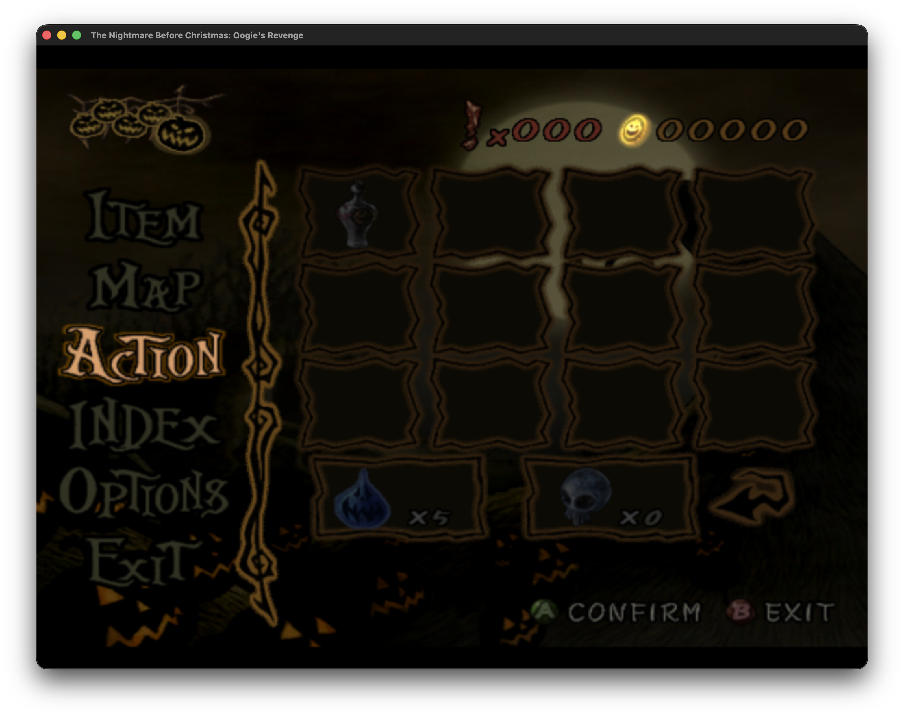

# *The Nightmare Before Christmas: Oogie's Revenge* - Native PC Port

### Native PC Reimplementation Engine & C++17 Reverse-Engineering Toolkit

[](https://en.cppreference.com/w/cpp/17)
[-lightgrey.svg)]()
[]()
[](https://github.com/ocornut/imgui)

A modern, high-performance **native PC port** and reverse-engineering toolkit for Capcom's 2004-2005 classic: ***Tim Burton's The Nightmare Before Christmas: Oogie's Revenge*** (Original Xbox / PS2).

Instead of running inside an emulator or waiting for a multi-year decompilation, the game's original x86 machine code runs **natively on the host CPU** with a 1:1 mapped PE binary, while graphics, input, audio, and OS calls are translated to modern Win32 and Direct3D 9 APIs.

---

## In-Game Screenshots (Native PC Port running under Wine / Direct3D 9)

| In-Game Gameplay (Jack in Halloween Town) | Chapter 1: Jack's Return (In-Game 3D) |
| :---: | :---: |
|  |  |
| **Title Screen (*Press Start Button*)** | **Options Menu** |
|  |  |
| **Action Menu (Soul Robber)** | **Inventory & Item Menu** |
|  |  |

> **Current Status:** The PC port boots directly into **active 3D gameplay** on Windows and under Wine on macOS. Jack Skellington (skeletal animation, Soul Robber, dynamic shadow projection), full 3D environments, 2D HUD overlays, and in-game pause/inventory menus are working. Sound (XACT stubs) and FMVs are in active development.

---

## Contents

- [Quick Start: Running the PC Port](#quick-start-running-the-pc-port)
- [How It Works (Architecture)](#how-it-works-architecture)
- [Debug Switches](#debug-switches)
- [3D Stage Viewer & Research Toolkit](#3d-stage-viewer--research-toolkit)
- [Technical Documentation](#technical-documentation)
- [Project Structure](#project-structure)
- [License](#license)

---

## Quick Start: Running the PC Port

### 1. Generate the PC Executable (`default_pc.exe`)

```bash
# Clone the repository
git clone https://github.com/BlackLineInteractive/nightmare-before-christmas-pc.git
cd nightmare-before-christmas-pc

# Generate flat 1:1 PE with patched libraries and src/PC/ runtime
python3 tools/build_flat_pe.py
```

*Prerequisites: `rom/extracted/default.xbe` from the original game disc and `clang` with x86 backend.*

### 2. Run the Game

Run from `rom/extracted/` so the game accesses its original assets:

```bash
# Windows
cd rom/extracted && default_pc.exe

# macOS / Linux (via Wine)
cd rom/extracted && wine default_pc.exe
```

---

## How It Works (Architecture)

The original Xbox uses an Intel Pentium III (x86 32-bit). Because modern PCs also run x86 instructions natively, the game code executes directly on the CPU without emulation overhead.

```text
[ Original default.xbe (Xbox) ]
                 │
                 ▼ (tools/build_flat_pe.py)
[ Flat Windows PE: default_pc.exe ]
  ├── 1. Memory mapped at base 0x00010000 (1:1 with Xbox layout)
  │      ↳ All absolute pointers, jump tables, Capcom globals stay valid
  │
  ├── 2. Hardware patches (NV2A MMIO neutralized)
  │      ↳ D3D_WaitGPUReady spin-waits & NV2A register polling patched to NOPs
  │
  ├── 3. XAPI / Kernel thunking -> Win32 (tools/xapi_port.py)
  │      ↳ Xbox APIs jump directly to kernel32.dll / ntdll.dll twins
  │      ↳ Drive paths (D:\, U:\) mapped to game directories
  │
  └── 4. Native PC backend (src/PC/)
         ├── D3D8 (Xbox) ──────► Direct3D 9 (render.c, draw.c)
         ├── NV2A Shaders ─────► HLSL (nv2a_vsh.py)
         ├── XPP Gamepad ──────► XInput + Keyboard (input.c)
         └── XACT Sound ───────► DirectSound stubs (audio.c)
```

### Porting Route

Static analysis confirmed **the game code itself (`0x12000`-`0x1A0000`) never calls the Xbox kernel**. All 125 kernel imports belong to Microsoft's statically linked libraries, which we replace:

| Library | Location | Kernel calls | PC Replacement |
| :--- | :--- | ---: | :--- |
| **XAPI + LIBC** | `.text` `0x1A0000`-`0x1D22A8` | 320 | Direct jumps to Win32 `kernel32.dll` / `ntdll.dll` |
| **D3D8 (NV2A)** | `D3D` | 37 | Direct3D 9 backend (`src/PC/render.c`, `draw.c`, `vshader.c`) |
| **XPP (Input)** | `XPP` | 160 | XInput + Keyboard mapping (`src/PC/input.c`) |
| **XACT / DSOUND**| `XACTENG` / `DSOUND` | 326 | Audio stubs & notification pumps (`src/PC/audio.c`) |
| **WMADEC** | `WMADEC` | 13 | Audio decoder (stubbed) |

---

## Debug Switches

Control runtime behavior via environment variables:

| Variable | Effect |
| :--- | :--- |
| `PC_SHOT=<n>` | Save the back buffer to `shot_<frame>.bmp` at frames *n*, 3*n*, 6*n* (**F12** saves anytime) |
| `PC_DUMPTEX=1` | Dump every uploaded texture to `tex_<addr>.bin` (header + raw data) |
| `PC_TRACE=<n>` | Log draw calls of frame *n* (prim, count, stride, shader, textures, blend states) |
| `PC_FLAT=1` / `2` | Debug drawing: vertex color only / texture × vertex color |

Press **T** at runtime to trace the next frame. Draw/texture stats log to stdout every 64 frames.

---

## 3D Stage Viewer & Research Toolkit

Alongside the binary port, **OogieEngine** includes a C++17 standalone viewer for inspecting extracted game assets:

- **Stage Browser:** Explore 365 cataloged stages (Halloween Town, Hinterlands, Lab, Casino, Christmas Town, Graveyard).
- **Model Hierarchy Inspector:** Toggle props, inspect vertex/poly counts, view bounding boxes.
- **Texture Gallery:** Real-time thumbnail preview of DXT1/DXT5 and `.pig` textures.
- **Dialogue Reader:** Multi-language BMS script viewer.
- **Dual Camera Navigation:** Turntable Orbit (LMB) & 6-DOF Flycam (RMB + WASD, Q/E).

### Building the Viewer (macOS)

```bash
cmake -B build -DCMAKE_BUILD_TYPE=Release
cmake --build build -j$(nproc 2>/dev/null || sysctl -n hw.ncpu)

# Run interactive viewer
./build/oogie_viewer

# Or inspect a specific stage
./build/oogie_viewer rom/structured_data/stages/020a
```

### Camera Controls

| Action | Control |
| :--- | :--- |
| **Turntable Orbit** | **LMB Drag** |
| **First-Person Fly** | **Hold RMB + WASD** |
| **Vertical Fly (Up/Down)** | **Q / E** (while holding RMB) |
| **Speed Boost / Adjust** | **Shift** / **Mouse Wheel** |
| **Pan / Zoom View** | **MMB Drag** / **Mouse Wheel** |
| **Focus Bounds / Grid** | **F** / **G** |
| **Render Modes** | **1** (Textured), **2** (Vertex Color), **3** (Wireframe), **4** (Flat), **5** (Normals) |

---

## Technical Documentation

Full reverse-engineering analysis and format specifications are documented in:  
👉 **[`docs/REVERSE_ENGINEERING_SPECIFICATION.md`](docs/REVERSE_ENGINEERING_SPECIFICATION.md)**

Includes: `default.xbe` structure, Capcom LZ Type 2 decompression, `@STM` containers, `P2OD`/`BMD`/`PMT` 3D formats, material flags (`ADD100`, `GLARE`, `TEX_SCROLL`), and collision meshes (`BGatari.amd`).

---

## Project Structure

```
├── media/                   # In-game screenshots & documentation assets
├── include/OogieEngine/     # Public C++ Header API (Core, Loader, Rendering, UI)
├── src/
│   ├── PC/                  # Native PC D3D9 / Win32 reimplementation (compiled into default_pc.exe)
│   ├── Host/                # Native host runtime
│   ├── Viewer/              # Interactive 3D asset viewer app
│   └── SG/, Loader/         # Scene graph, P2OD & STM parsers
├── docs/                    # Reverse-Engineering specifications
├── rom/                     # Extracted game assets & structured stage data
└── tools/
    ├── build_flat_pe.py     # default.xbe -> default_pc.exe generator
    ├── xapi_port.py         # XAPI -> Win32 thunk generator
    ├── pc_render.py         # D3D8 / XPP / XACT entry point dispatcher
    ├── nv2a_vsh.py          # NV2A vertex shaders -> HLSL
    └── capcom_tool.py       # LZ decompression & @STM extraction
```

---

## License

This project is developed for educational and preservation purposes.  
*Tim Burton's The Nightmare Before Christmas: Oogie's Revenge* is the property of Disney Interactive, Buena Vista Games, and Capcom Co., Ltd.
