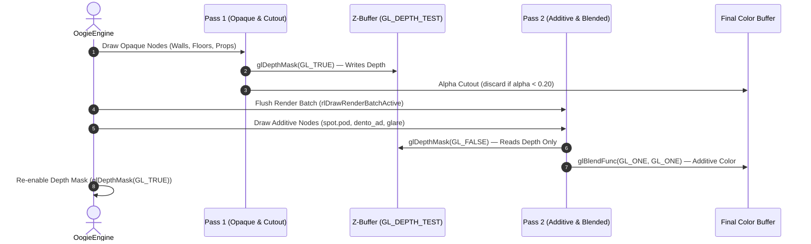

# Technical Specification & Reverse-Engineering Report
## Capcom RD3 Engine & *Tim Burton's The Nightmare Before Christmas: Oogie's Revenge* (Xbox)

**Document Version:** 1.0.0  
**Classification:** Reverse-Engineering & Native Engine Porting Specification  
**Target Platform:** Original Xbox (x86) $\to$ Cross-Platform PC Native Reimplementation (C++17)  
**Author:** Antigravity AI & BlackLine Interactive  

---

## 1. Executive Summary & System Architecture

*Tim Burton's The Nightmare Before Christmas: Oogie's Revenge* was developed by **Capcom Production Studio 3** (directed by Tsuyoshi Tanaka) and released in 2004–2005 for the Sony PlayStation 2 and Microsoft Xbox.

The game is powered by Capcom's proprietary **RD3 Engine** (a precursor to the *MT Framework*), featuring advanced skeletal animations, real-time lighting, interactive musical combat sequences, dynamic cloth simulation, and hierarchical level streaming.

```
       ┌────────────────────────────────────────────────────────┐
       │                Capcom RD3 Engine (Xbox)                │
       └───────────────────────────┬────────────────────────────┘
                                   │
         ┌─────────────────────────┼─────────────────────────┐
         ▼                         ▼                         ▼
┌──────────────────┐     ┌──────────────────┐     ┌──────────────────┐
│ default.xbe      │     │ stm_data/*.lz    │     │ XACT_data/*.xwb  │
│ (x86 32-bit PE)  │     │ (@STM Packages)  │     │ (Wave/Soundbank) │
├──────────────────┤     ├──────────────────┤     ├──────────────────┤
│ • jkmngsub.c     │     │ • P2OD Models    │     │ • Jack Voices    │
│ • y_character.c  │     │ • BMD Skinned    │     │ • BGM Streams    │
│ • y_camera.c     │     │ • PMT Animations │     │ • Sound FX       │
│ • JACK_00..16    │     │ • DXT5 Textures  │     │ • Cues / Events  │
└──────────────────┘     └──────────────────┘     └──────────────────┘
```

---

## 2. Executable Architecture & Static Analysis (`default.xbe`)

### 2.1 Hardware Architecture & Execution Model
Unlike the PlayStation 2 edition (which targets the 128-bit MIPS R5900 Emotion Engine with custom VU0/VU1 vector co-processors), the Xbox executable (`default.xbe`) runs natively on **Intel IA-32 (32-bit x86)** architecture:
- **CPU:** Intel Mobile Pentium III (Coppermine core), 733 MHz, 32 KB L1 cache, 256 KB on-die L2 cache.
- **GPU:** Nvidia NV2A (GeForce 3 / 4 derivative, programmable vertex/pixel shaders).
- **Endianness:** Little-Endian (identical to modern x86-64 and ARM64 Apple Silicon).
- **Float Format:** Standard IEEE-754 32-bit single-precision floating-point.
- **Compiler:** Microsoft Visual C++ 7.1 (Visual Studio .NET 2003 / Xbox SDK 5849+).

### 2.2 XBE Image Layout
- **Image Magic:** `XBEH` (`0x48454258`)
- **Title ID:** `0x42560004` (Buena Vista Games / Capcom)
- **Base Address:** `0x00010000`
- **Virtual Image Size:** 4,328,064 bytes (4.13 MB)
- **Sections:** 31 discrete sections including:
  - `.text` (Raw offset: `0x00002000`, Size: 1,835,688 bytes): Primary x86 instruction stream.
  - `.rdata` (Raw offset: `0x0025E000`, Size: 133,700 bytes): Read-only tables, strings, virtual tables.
  - `.data` (Raw offset: `0x0027F000`, Size: 896,324 bytes): Global engine state, object pools, stage descriptors.
  - Subsystem libraries: `D3D`, `DSOUND`, `XACTENG`, `BINK`, `WMADEC`, `XPP`.

### 2.3 Recovered Capcom Source File Hierarchy
Embedded assertion strings, debug symbols, and path references reveal the internal source tree structure used by Capcom's development team:
```
\Project\nightmareXbox\app\
├── jack\
│   └── jkmngsub.c         # Jack Skellington Player Manager & State Machine
├── char_unit.c            # Character Entity Unit Base
├── y_character.c          # Character Physics, Skeletons & Locomotion
├── y_camera.c             # 3rd-Person Dynamic Action & Cinematic Camera
├── world.c                # World & Level Composition Engine
├── scene.c                # Stage Scene Graph & Object Placement
├── figure.c               # 3D Model & Collectible Figure Viewer
├── pkdatload.c            # Package Data Loader (Capcom LZ / @STM)
├── effman.c               # Visual Particle & Special Effects Manager
├── tex_ex.c               # Texture Animation & UV Scrolling Subsystem
├── seseq.c                # Sound Effect Sequencer & Voice Routing
└── demo\
    ├── demo.c             # Cutscene Orchestration Engine
    ├── demo_player.c      # Cutscene Actor Controller
    ├── demo_event.c       # Scripted Timeline Event Trigger
    └── demo_object.c      # Dynamic Cutscene Prop Manager
```

### 2.4 State Machine & Gameplay Strings
The binary defines Jack Skellington's core player state machine via discrete action constants:
- **State Identifiers:** `JACK_00` through `JACK_16` (Idle, Walk, Run, Jump, Fall, Land, Attack Light 1-3, Attack Heavy, Whip Throw, Grapple, Slam, Damage, Death).
- **Costume Types:**
  - `jack0`: Default Jack Skellington (with Soul Robber green whip).
  - `jack1`: Pumpkin King (Fire breath / Flamethrower combat mode).
  - `jack2` / `jack/sntprs`: Santa Jack (Ice / Freezing present delivery weapons).
- **Enemy Subsystems:** `enemy0/skltroll` (Skeleton Troll), `enemy0/kngghost` (King Ghost), `enemy0/sklorc` (Skeleton Orc), `enemy0/trick`, `enemy0/treat` (Halloween Trick-or-Treaters).

### 2.5 Xbox Dependency Map

#### Header facts
- **Entry point:** stored XOR `0xA8FC57AB` (retail key) → `0x001BF647` (`mainXapiStartup`), which creates the main thread at `0x001BF5D3`.
- **Kernel thunk table:** XOR `0x5B6D40B6` → `0x00260020`, 125 ordinals of `xboxkrnl.exe`.
- **Certificate:** `0x00010184`, **section headers:** `0x00010370`, **TLS directory:** `0x0027C600`.
- **Title ID:** `0x42560004`, region PAL.

#### Section layout

| Section | VA range | Contents |
| :--- | :--- | :--- |
| `.text` | `0x012000`–`0x1D22A8` | Capcom RD3 game code (`0x012000`–`0x1A0000`), then XAPI + LIBC |
| `D3D` | `0x1D22C0`–`0x1E5228` | Direct3D 8 (NV2A push-buffer driver) |
| `D3DX` | `0x1E5240`–`0x202098` | D3DX helpers |
| `XGRPH` | `0x2020A0`–`0x204194` | XGraphics (swizzle, etc.) |
| `DSOUND` | `0x2041A0`–`0x222AB4` | DirectSound (MCPX APU driver) |
| `XACTENG` | `0x222AC0`–`0x22D5D0` | XACT audio engine |
| `BINK*` | `0x22D5E0`–`0x23F5EC` | Bink video codec + blitters |
| `WMADEC` | `0x23F600`–`0x25867C` | WMA decoder |
| `XPP` | `0x258680`–`0x26001C` | Xbox Peripheral Port (USB gamepad) |
| `.rdata` | `0x260020`–`0x280A74` | kernel thunks, constants, strings |
| `.data` | `0x280A80`–`0x41847C` | globals |
| `DOLBY`, `BINKDATA` | `0x418480`–`0x42CB60` | DSP / codec data |

#### Linked XDK libraries
All at build **5849**: `XAPILIB`, `D3D8`, `D3DX8`, `XGRAPHC`, `DSOUND`, `XACTENG`, `XBOXKRNL`, `LIBCMT`, `LIBCPMT`.

`tools/xbsymscan.py` matches these against XbSymbolDatabase signatures and finds 361 functions. Key ones:

| Address | Symbol |
| :--- | :--- |
| `0x001D8EE0` | `Direct3D_CreateDevice` (device object is static at `0x001E2D30`, size `0x24A0`; `D3D_g_pDevice` at `0x001E2D28`) |
| `0x001D7610` | `D3DDevice_Clear` |
| `0x001D7460` | `D3DDevice_Swap` |
| `0x001D6370` | `D3DDevice_DrawVertices` |
| `0x001D2E00` | `D3DDevice_SetStreamSource` |
| `0x001D82C0` | `D3DDevice_MakeSpace` |
| `0x002076AA` | `DirectSoundCreate` |
| `0x0025986B` | `XInputOpen` |
| `0x00259AA5` | `XInputGetState` |

#### Who calls the Xbox kernel

| Caller | Kernel call sites | Distinct kernel functions |
| :--- | ---: | ---: |
| `.text` — only in XAPI/LIBC (`0x1A0000`+) | 320 | 90 |
| `DSOUND` | 186 | 29 |
| `XPP` | 160 | 36 |
| `XACTENG` | 140 | 12 |
| `D3D` | 37 | 24 |
| `WMADEC` | 13 | 3 |

**The Capcom game code (`0x012000`–`0x1A0000`) has no direct kernel calls.** It talks only to XAPI (a Win32 subset: `CreateFileA`, `ReadFile`, `CreateThread`, `Sleep`, …), LIBC, and the D3D / DSound / XACT / XPP libraries.

#### KPCR (`fs:`) accesses
Xbox code reads the kernel processor control region through `fs:`: `fs:[0x20]` Prcb (10 sites), `fs:[0x28]` CurrentThread (9), `fs:[0x58]` DpcRoutineActive (2), `fs:[0x04]` StackBase for TLS (6), `movzx fs:[0x24]` Irql (12). TLS: `[StackBase + idx*4]`, index stored at `0x003F2E5C`.

#### NV2A register access inside D3D
D3D drives the GPU directly at `0xFD000000`; on PC these addresses are plain memory, so the driver hangs or recurses:
- `0x001D7E70`: waits for the write-combine flush (`NV_PFB 0x100410`).
- `0x001DA690`: waits for PFIFO DMA `GET == PUT` (user channel `0xFD800040/44`).
- `0x001DBED0`: GPU interrupt handler; reads `NV_PGRAPH_INTR` (`0xFD400100`), which on hardware is cleared by writing it. On plain memory the bit never clears, so `0x001DFADD` ↔ `0x001DBED0` recurse until the stack overflows (`0x001DFAE2`).
- Commands are written to a push buffer: `D3D_g_pDevice+0` = put pointer, `+4` = threshold; `0x001D82D0` reserves space and `0x001D8180` kicks/waits on the GPU when it runs out.

Patching these registers one by one is a dead end; the D3D library as a whole is to be replaced.

---

## 3. Data Storage & Compression Algorithms

Game assets are packed into monolithic `.lz` compressed archives located in `rom/extracted/stm_data/` and loaded dynamically per stage.

### 3.1 Capcom LZ Type 2 Bitstream Decompression
The compression algorithm is a bit-level sliding window LZ dictionary variant:
- **Header:** 5 bytes (`0x00..0x04` = decompressed payload size as 32-bit unsigned little-endian integer).
- **Bitstream Reader:** 32-bit dwords read sequentially, processed from Least Significant Bit (bit 0) to Most Significant Bit (bit 31).
- **Decompression Grammar:**
  1. Read 1 control bit:
     - `bit == 0`: **Literal byte**. Read 8 raw bits from the bitstream and output to destination buffer.
     - `bit == 1`: **Match Reference**. Read 1 additional selector bit:
       - `bit == 0`: **Short Match**.
         - Length = 2 bytes.
         - Offset = Read 8 bits + 1 (1 to 256 bytes backward).
       - `bit == 1`: **Variable Match**.
         - Read 2-bit length selector:
           - `0b00`: Match length = 3 bytes.
           - `0b01`: Match length = 4 bytes.
           - `0b10`: Match length = 5 bytes.
           - `0b11`: Extended length. Read 8 bits + 6 (6 to 261 bytes).
         - Read 11 bits for backward offset + 1 (1 to 2048 bytes backward).
  2. Repeat until destination byte count matches header payload size.

### 3.2 `@STM` Multi-File Archive Format
Once decompressed, the payload begins with the 4-byte ASCII magic `@STM`:
```
Offset  Size  Type       Description
0x00    4     char[4]    Archive Magic ('@STM')
0x04    4     uint32     Header Size / Data Start Offset
0x08    4     uint32     Number of Contained Files (N)
0x0C    4     uint32     Archive Version / Alignment (typically 0x00000001)
[0x10 + i * 8]:
  +0x00 4     uint32     File Data Absolute Offset
  +0x04 4     uint32     File Data Size in Bytes
```
Payloads recursively nest inner `@STM` sub-archives, splitting stages into clean hierarchical directories:
- `models/`: 3D meshes (`.pod`, `.bmd`, `.amd`).
- `textures/`: Texture streams (`.dds`, `.pig`).
- `scene/`: Stage layout (`bg_list.txt`, `cnfg.txt`, `test.cam`, `test.lgt`).
- `collision/`: Collision terrain (`hm*.hm`, `BGatari.amd`).
- `logic/`: Script bytecode (`event.atr`, `event.lgc`).
- `messages/`: Dialogues (`event.txt`, `event.bms`).
- `audio/`: Stage sound effects (`se*.sec`).

---

## 4. 3D Mesh & Skeletal Geometry Formats

### 4.1 Static Geometry: `P2OD` Format
Static stage environments (buildings, terrain, props, interiors) use the `P2OD` container:
- **Magic:** `P2OD` (`0x444F3250`).
- **Object Hierarchy:** Header at `0x08` defines `numObjects`. Each object header (`0x50` bytes) contains an internal $4 \times 4$ column-major transformation matrix and an offset to its mesh geometry descriptor.

#### Inverted Y-Axis Coordinate System
Capcom RD3 on Xbox uses a left-handed coordinate system where **negative Y points upward into the sky**. To map to standard OpenGL right-handed coordinates ($Y = \text{up}$), positions and transformation matrices require inversion:
$$Y_{\text{OpenGL}} = -Y_{\text{Capcom}}$$
$$\mathbf{M}_{\text{OpenGL}} = \mathbf{S}_y \cdot \mathbf{M}_{\text{Capcom}} \cdot \mathbf{S}_y, \quad \text{where } \mathbf{S}_y = \operatorname{diag}(1, -1, 1, 1)$$

#### Vertex Buffer Layout
Each submesh contains interleaved attribute streams:
1. **Position Buffer:** `numVerts * 16 bytes` $\to$ `[float x, float y, float z, uint32 flag]`
2. **Color Buffer:** `numVerts * 16 bytes` $\to$ `[float r, float g, float b, float a]`
3. **Texture Coordinate Buffer:** `numVerts * 16 bytes` $\to$ `[float u, float v, float padding0, float padding1]`

#### Triangle Strip Expansion & The `0x8000` Emit Flag
Vertices are packed as triangle strips. The 4th float of each position vector is an encoded 32-bit integer status flag:
- **`flag & 0x8000 == 0`**: Strip restart / initialization marker. Resets the active strip counter to $0$. Must **not** emit a triangle.
- **`flag & 0x8000 != 0`**: Strip emit marker. Increments strip counter. When `stripStep >= 1` and `vi >= 2`, emits a triangle with alternating vertex winding:
  $$\text{If } (\text{stripStep} \pmod 2 == 1): \triangle = (v_{i-2}, v_i, v_{i-1})$$
  $$\text{If } (\text{stripStep} \pmod 2 == 0): \triangle = (v_{i-1}, v_i, v_{i-2})$$
- Degenerate triangles ($v_0 = v_1$ or $v_1 = v_2$ or $v_0 = v_2$) are skipped.

#### Vertex Color Intensity (PS2 GS Hardware Inheritance)
Because the RD3 engine was originally architected for the Sony PlayStation 2 Graphics Synthesizer, color registers treat $128.0$ (`0x80`) as $1.0\times$ (full diffuse intensity):
$$C_{\text{normalized}} = \operatorname{clamp}\left(\frac{C_{\text{vertex}}}{128.0}, 0.0, 1.0\right)$$
Values above $128.0$ allow over-bright highlights.

---

### 4.2 Skinned Character Meshes: `BMD` Format
Character actors (Jack Skellington `chja2.bmd`, enemies `skltroll.bmd`, bosses `oogie.bmd`) use the **Bone Mesh Data** format:
- Hierarchical skeleton joint trees with parent-child indices.
- Local bind-pose translation vectors and rotation quaternions.
- Vertex skinning weights (1 to 4 bone influences per vertex).
- Attachment points: Dynamic accessory sockets (e.g. `ATTACH=chja2,18` binds Jack's head `chph1.bmd` to neck bone 18).

### 4.3 Animation Streams: `PMT` Format
The 134 motion files in `pmt/` contain skeletal animation tracks:
- Header defines frame count, duration, playback rate (typically 30 FPS / 60 FPS), and bone channel count.
- Keyframe tracks contain timestamped delta transformations for root motion, translation, and rotational quaternions.

---

## 5. Scene Composition & Material Semantics (`scene/bg_list.txt`)

Every level contains a layout file `scene/bg_list.txt` specifying stage assembly and blending rules:
```
e_room
bed        ADDZERO_B64
tukue
dentou
frasco     ADD100
spot       ADD100
dento_ad   ADD100
kikai_ad   GLARE
BGatari    ATR_MODEL
CAMatari   CAM_MODEL
```

### Complete Grammar of Engine Material Flags
| Flag Name | Shader / Blending Mode | Depth Buffer Action | Functional Purpose |
| :--- | :--- | :--- | :--- |
| **`ADD100`** | Additive (`GL_ONE, GL_ONE`) | Depth Write `FALSE` | Spotlights, light cones, lantern beams, magical glow |
| **`GLARE`** | Additive (`GL_ONE, GL_ONE`) | Depth Write `FALSE` | Lens flares, machine electrical arcing |
| **`ADDZERO_64`** | Shadow Blending (`GL_ZERO, GL_SRC_COLOR`) | Depth Write `FALSE` | Dynamic shadow projection under furniture (50% darkness) |
| **`ADDZERO_B64`**| Shadow Blending (`GL_ZERO, GL_SRC_COLOR`) | Depth Write `FALSE` | Character shadow casting planes |
| **`ALPHA`** | Cutout / Alpha Blend | Depth Write `TRUE` / `FALSE` | Cutout foliage, iron fences, translucent windows |
| **`Z_OFF`** | Normal / Alpha Blend | Depth Write `FALSE` | Skyboxes, background panoramas |
| **`FOG_OFF`**| Shader Uniform `uFogEnabled = 0` | Standard | Interior props unaffected by atmospheric world fog |
| **`TEX_SCROLL`**| Dynamic UV offset animation | Standard | Flowing liquids (`mizu`), swirling mist (`kiri`), clouds (`kumo`) |
| **`ATR_MODEL`**| Collision Entity (Invisible) | No Render | World physics collision mesh |
| **`CAM_MODEL`**| Collision Entity (Invisible) | No Render | Camera obstruction volume to prevent wall clipping |

---

## 6. Two-Pass Render Pipeline Specification

To eliminate Z-fighting, opaque backdrop clipping, and transparent quad occlusion, the renderer executes a **Two-Pass Scene Graph**:



### Custom GLSL Shader Implementation
```glsl
#version 330
in vec2 fragTexCoord;
in vec4 fragColor;
in vec3 fragNormal;

uniform sampler2D texture0;
uniform vec4 colDiffuse;
uniform int uRenderMode;
uniform int uIsAdditive;

out vec4 finalColor;

void main() {
    vec3 lightDir = normalize(vec3(0.4, 0.9, 0.3));
    float diff = max(dot(fragNormal, lightDir), 0.0);
    float light = diff * 0.45 + 0.55;

    if (uRenderMode == 0) { // Textured
        vec4 texColor = texture(texture0, fragTexCoord);
        if (uIsAdditive == 1) {
            // Additive mode: multiply by vertex color to fade quad borders to pure zero
            vec3 vCol = length(fragColor.rgb) > 0.01 ? fragColor.rgb : vec3(1.0);
            vec3 addColor = texColor.rgb * vCol;
            addColor = max(addColor - vec3(0.04), vec3(0.0)); // Suppress DXT noise
            finalColor = vec4(addColor, 1.0);
        } else {
            if (texColor.a < 0.20) discard; // Alpha cutout for foliage and fences
            finalColor = vec4(texColor.rgb * colDiffuse.rgb * light, texColor.a * colDiffuse.a);
        }
    } else if (uRenderMode == 1) { // Vertex Colors
        finalColor = vec4(fragColor.rgb * light, 1.0);
    } else if (uRenderMode == 2) { // Wireframe
        finalColor = vec4(0.39, 0.86, 1.0, 1.0);
    } else if (uRenderMode == 3) { // Flat Shaded
        finalColor = vec4(vec3(light), 1.0);
    } else if (uRenderMode == 4) { // Normals
        finalColor = vec4(fragNormal * 0.5 + 0.5, 1.0);
    }
}
```

---

## 7. Camera Navigation & Interaction Engine

The camera controller provides two modes:
1. **Turntable Orbit Mode (LMB Drag / Wheel Zoom):**
   - Natural turntable rotation around the model's bounding box center.
   - Smooth exponential zoom: $\text{dist} \leftarrow \text{dist} \times (1.0 - \text{wheel} \times 0.12)$.
   - Configurable vertical pitch and horizontal yaw inversion.
2. **First-Person Fly Navigation (RMB Hold + WASD):**
   - Holding RMB locks mouse-look for 6-DOF inspection.
   - Keys **W / S / A / D / Q / E** fly through level geometry with full velocity control.
   - Shift accelerates flight by $2.5\times$; mouse wheel adjusts base velocity dynamically.

---

## 8. Native PC Port / Reimplementation Roadmap

```
┌────────────────────────────────────────────────────────────────────────┐
│                        OogieEngine PC Port                             │
└───────────────────────────────────┬────────────────────────────────────┘
                                    │
    ┌───────────────┬───────────────┼───────────────┬────────────────┐
    ▼               ▼               ▼               ▼                ▼
[Phase 1]       [Phase 2]       [Phase 3]       [Phase 4]        [Phase 5]
Character &     Physics &       Combat &        Enemy AI &       Audio &
Skeletons       Collision       Soul Robber     Encounters       Cutscenes
• BMD Reader    • BGatari.amd   • Whip physics  • enemy.arg      • XWB Audio
• PMT Player    • Raycast floor • Combos        • Skeleton AI    • Dialogue
• Jack Model    • Wall sliding  • Form shifts   • Boss logic     • Subtitles
```

### Phase 0: Binary Port of `default.xbe`
Run the original game code on PC by patching the executable (no emulation, no recompilation). See §2.5 for the addresses.
1. **Flat PE** (`tools/build_flat_pe.py`, done): XBE mapped 1:1 at `0x00010000`, NV2A init/waits stripped, entry jumps to the main thread routine.
2. **XAPI → Windows:** each XAPI function becomes a jump into the same function of `kernel32.dll`; `D:\` paths point at the game folder; XAPI start-up is skipped. With this the Xbox kernel is not needed at all.
3. **Renderer:** replace the D3D8 entry points (`Direct3D_CreateDevice`, `Clear`, `Swap`, draw/state functions) with our own renderer; first milestone is a presented frame.
4. **Input:** replace `XInputOpen` / `XInputGetState` (XPP) with PC gamepad/keyboard.
5. **Audio:** replace DirectSound / XACT / WMA with our own mixer reading the original `.xwb` / `.xsb` banks.

### Phase 1: Jack Skellington Skeletal Animation System
- Implement `BmdLoader`: Parse joint hierarchy, bind matrices, and vertex weights from `chja2.bmd`.
- Implement `PmtPlayer`: Decode keyframe translation/rotation curves from `pmt/` motions.
- Render Jack in idle pose with real-time skeletal skinning on GPU (Compute Shader or Vertex Shader matrix palette).

### Phase 2: Collision & Locomotion Controller
- Implement `AmdLoader`: Parse collision triangles from `BGatari.amd`.
- Build spatial bounding hierarchy (BVH / Octree) for collision queries.
- Add capsule-to-mesh collision detection: Jack walks on stairs, bridges, and uneven terrain with gravity and slope sliding.
- Integrate 3rd-person follow-camera replicating Capcom's `y_camera.c`.

### Phase 3: Combat Mechanics & The Soul Robber
- Implement Jack's green rubber whip mechanics (`rubber/`):
  - Chain physics / Catmull-Rom spline whip rendering.
  - Attack combo chains (Light $\times$ 3, Heavy slam).
  - Overhead grappling from gargoyles and lampposts.
- Implement costume shifting (Santa Jack present throw, Pumpkin King fire attack).

### Phase 4: Enemy Encounters & Scripting
- Parse `arrange/enemy.arg` to place enemy spawners in each stage.
- Implement basic enemy state machines: Skeletons (`skltroll`), Ghosts (`kngghost`), and Trick-or-Treaters (`trick`, `treat`).

### Phase 5: Sound, Music & Musical Boss Battles
- Implement audio backend for Microsoft XACT `.xwb` / `.xsb` wavebanks.
- Stream background music and voice lines.
- Implement timing rhythm-action mechanics for musical boss encounters against Oogie Boogie, Lock, Shock, and Barrel.

---

## 9. Conclusion & Reference Links

With the Xbox architecture being native 32-bit x86 Little-Endian and all 365 stages, textures, character packages, and level compositions fully structured, *The Nightmare Before Christmas: Oogie's Revenge* is an exceptional candidate for a modern native 60+ FPS PC port.

- **Engine Repository:** `OogieEngine` (C++17 / Raylib / OpenGL / Dear ImGui)
- **Reference Toolkit:** [`BlackLineInteractive/Climax_Game_Engine_Toolkit`](https://github.com/BlackLineInteractive/Climax_Game_Engine_Toolkit)
- **Executable Target:** `rom/extracted/default.xbe`
- **Extracted Datasets:** `rom/structured_data/`

